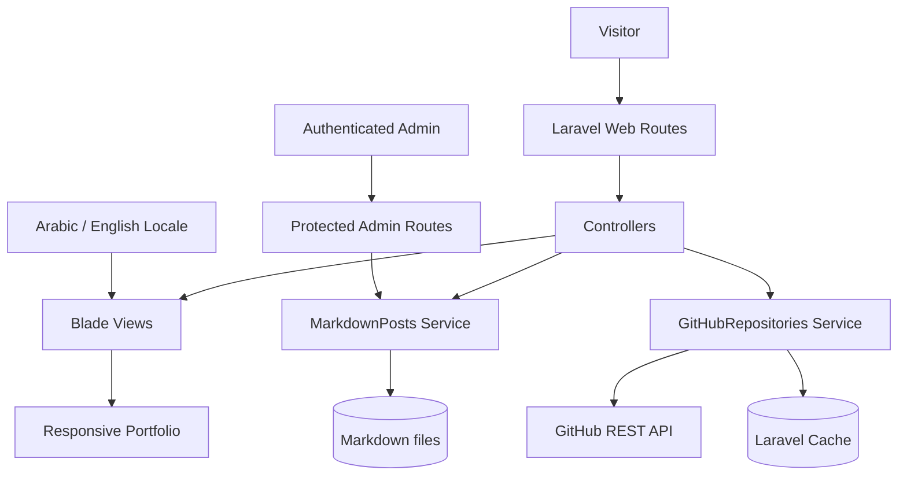

# ABRAHYM — Personal Portfolio

<p align="center">
  <strong>A personal space for software engineering, artificial intelligence, and ideas worth building.</strong>
</p>

<p align="center">
  <a href="https://github.com/abrahymZy/personal-website"></a>
  
  
  
  
</p>

<p align="center">
  <a href="https://github.com/abrahymZy">GitHub Profile</a> ·
  <a href="https://github.com/abrahymZy/personal-website">Source Code</a> ·
  <a href="https://github.com/abrahymZy/personal-website/issues">Report an Issue</a>
</p>

---

## Overview

**ABRAHYM** is a bilingual personal portfolio and developer website built with Laravel. It presents professional experience, technical interests, selected projects, academic research interests, and a writing space in one cohesive experience.

The website is designed around a simple idea: **turn ideas into meaningful digital solutions**. Its content reflects a multidisciplinary background in Information Technology, software development, systems, and emerging AI technologies, with a growing research focus on AI for assistive technologies.

> This repository contains the source code for the portfolio website. It is a personal project and is not intended to be a generic portfolio template.

## Key Features

- **Arabic and English:** switch between Arabic (RTL) and English (LTR), with locale preference stored in the session.
- **Responsive portfolio:** dedicated sections for introduction, about, expertise, featured projects, research, experience, education, and contact.
- **Theme preferences:** light, dark, and system-based appearance.
- **GitHub-powered projects:** fetches public repositories from the configured GitHub account, separates featured systems from experiments, and caches the response.
- **Markdown blog:** publish articles in Arabic or English using Markdown files with metadata, tags, summaries, and estimated reading time.
- **Admin area:** authenticated dashboard for creating, editing, uploading, filtering, and deleting blog posts.
- **CV download:** provides a downloadable PDF résumé from the public assets directory.
- **Accessibility-minded interface:** semantic page structure, skip link, descriptive labels, and keyboard-operable controls.
- **SEO foundations:** page-specific titles and descriptions.

## Portfolio Sections

| Section | What it presents |
|---|---|
| About | Background, development journey, and long-term direction |
| Expertise | Programming, web and mobile development, databases, AI, networks, and embedded systems |
| Featured Projects | AI Assistive Vision, School Management System, Privacy Survey Platform, and Smart City & Autonomous Car |
| Research | AI for Assistive Technologies, Deep Learning, Computer Vision, VQA, and Edge AI |
| Experience | IT systems and network administration experience |
| Education | Information Technology studies at National University |
| Blog | Technical articles and practical notes |
| Contact | Links and ways to connect |

## Technology Stack

| Area | Technologies |
|---|---|
| Backend | PHP 8.3+, Laravel 13 |
| Frontend | Laravel Blade, HTML, CSS, JavaScript |
| Asset bundling | Vite 8, Laravel Vite Plugin |
| Content | Markdown, League CommonMark |
| External data | GitHub REST API |
| Testing | PHPUnit, Laravel testing tools |
| Local database default | SQLite (configurable through Laravel database settings) |

The interface is rendered with **Blade**; the project does not use a separate frontend SPA framework.

## How It Works

The application is organized around Laravel routes, controllers, services, Blade views, and translation files.



### Project and repository data

The projects page retrieves public repositories for the account configured in `config/projects.php`. Repositories are grouped into featured projects and lab/experimental work. Results are cached to reduce repeated GitHub API requests. If GitHub cannot be reached, the service safely returns an empty collection and the page displays its fallback message.

### Blog content and administration

Blog posts are stored as Markdown files under `resources/content/posts`, not as database records. File names follow this convention:

```text
{post-key}.{locale}.md
```

For example:

```text
markdown-guide.en.md
markdown-guide.ar.md
```

Each post can include front matter:

```yaml
---
title: "A Practical Markdown Guide"
date: 2026-11-19
tags: [markdown, writing, tutorial]
summary: "A short introduction to writing and publishing posts."
---

Your article content starts here...
```

The admin interface is protected by Laravel authentication. It supports writing posts in the browser or uploading Markdown files, editing existing posts, filtering the post list, and deleting posts. Login attempts are rate-limited.

## Getting Started

### Requirements

- PHP **8.3 or later**, with the extensions required by Laravel.
- Composer.
- Node.js and npm (use a version supported by Vite 8).
- Git.
- SQLite for the default local database, or another database supported by Laravel.

### 1. Clone the repository

```bash
git clone https://github.com/abrahymZy/personal-website.git
cd personal-website
```

### 2. Install PHP dependencies

```bash
composer install
```

### 3. Configure the environment

Create your local environment file:

```bash
cp .env.example .env
php artisan key:generate
```

On Windows Command Prompt, use:

```bat
copy .env.example .env
php artisan key:generate
```

The example configuration uses SQLite. Create the database file if it does not exist.

**macOS / Linux:**

```bash
touch database/database.sqlite
```

**Windows PowerShell:**

```powershell
New-Item -ItemType File -Force database/database.sqlite
```

Then run the migrations:

```bash
php artisan migrate
```

If you prefer MySQL or another supported database, update the DB settings in `.env` before running migrations.

### 4. Install frontend dependencies

```bash
npm install
npm run build
```

For frontend development with hot reload, use:

```bash
npm run dev
```

### 5. Start the application

```bash
php artisan serve
```

Open [http://127.0.0.1:8000](http://127.0.0.1:8000).

For a convenient local development workflow, the project also defines a Composer development script:

```bash
composer run dev
```

## Admin Access

The admin area is available at:

```text
/admin/login
```

There is no public self-registration flow. Create an administrator account deliberately in your local environment, for example with Laravel Tinker:

```bash
php artisan tinker
```

Then run:

```php
\App\Models\User::create([
    'name' => 'Site Administrator',
    'email' => 'admin@example.com',
    'password' => 'use-a-strong-unique-password',
]);
```

Use the account credentials to sign in. **Do not commit real credentials, production environment files, or application keys to the repository.**

## Useful Commands

| Command | Purpose |
|---|---|
| `php artisan serve` | Start the local Laravel server |
| `npm run dev` | Start Vite in development mode |
| `npm run build` | Compile production frontend assets |
| `php artisan migrate` | Run database migrations |
| `php artisan test` | Run the test suite |
| `./vendor/bin/pint` | Format PHP code with Laravel Pint |
| `php artisan optimize:clear` | Clear Laravel's cached configuration, routes, and views |

## Configuration

A few project-specific settings are defined in `config/projects.php`:

- **owner:** GitHub username used to retrieve public repositories.
- **cache_minutes:** cache duration for a successful GitHub repository response.
- **repos:** repository names, display titles, and portfolio grouping (`featured` or `lab`).

The default GitHub account is `abrahymZy`. Update these values if you intentionally adapt the project for another account.

Other application settings—including database, locale defaults, sessions, cache, and application URL—are managed through Laravel's standard `.env` configuration.

## Repository Structure

```text
personal-website/
├── app/
│   ├── Http/
│   │   ├── Controllers/       # Portfolio, projects, blog, and admin controllers
│   │   └── Middleware/        # Locale handling
│   ├── Models/                # Eloquent models
│   └── Services/              # GitHub repository and Markdown services
├── config/                    # Laravel and project configuration
├── database/                  # Migrations, factories, and seeders
├── lang/
│   ├── ar/                    # Arabic translations
│   └── en/                    # English translations
├── public/
│   └── cv/                    # Public CV assets
├── resources/
│   ├── content/posts/         # Arabic and English Markdown articles
│   ├── css/                   # Application styles
│   ├── js/                    # Frontend interactions
│   └── views/                 # Blade layouts, pages, and components
├── routes/                    # Web and console routes
├── tests/                     # Feature and unit tests
├── composer.json
├── package.json
└── vite.config.js
```

## Testing

Run the automated test suite with:

```bash
php artisan test
```

Before submitting changes, also build the frontend assets:

```bash
npm run build
```

## Deployment Notes

For a production deployment:

1. Configure a production `.env` file and set `APP_ENV=production` and `APP_DEBUG=false`.
2. Set a secure `APP_KEY` and configure the production database, cache, and session drivers.
3. Point the web server document root to the Laravel `public/` directory.
4. Install dependencies and build frontend assets:

   ```bash
   composer install --no-dev --optimize-autoloader
   npm ci
   npm run build
   ```

5. Run database migrations during deployment:

   ```bash
   php artisan migrate --force
   ```

6. Ensure `storage/` and `bootstrap/cache/` are writable by the web-server process.
7. Configure HTTPS, backups, and a secure administrator account.

Do not expose the project root as the public web root, and never publish the `.env` file.

## Roadmap

- [ ] Add verified screenshots of the desktop and mobile layouts.
- [ ] Add a public live-demo URL when production hosting is available.
- [ ] Expand automated coverage for portfolio, localization, and admin workflows.
- [ ] Continue refining accessibility and performance.

## Author

**Abrahym** — Information Technology, software development, and AI research interests.

- GitHub: [@abrahymZy](https://github.com/abrahymZy)
- Portfolio source: [personal-website](https://github.com/abrahymZy/personal-website)

---

<p align="center">
  <sub>Built with Laravel, curiosity, and a commitment to continuous learning.</sub>
</p>
